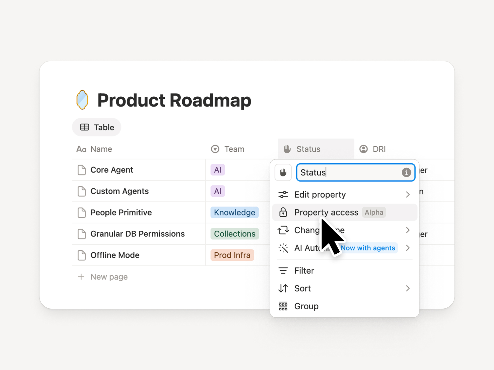
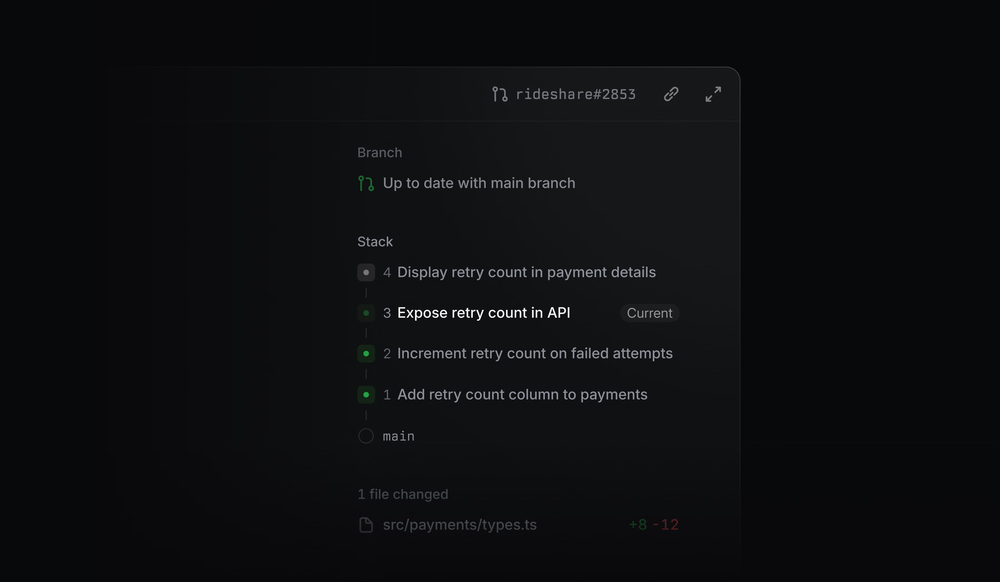
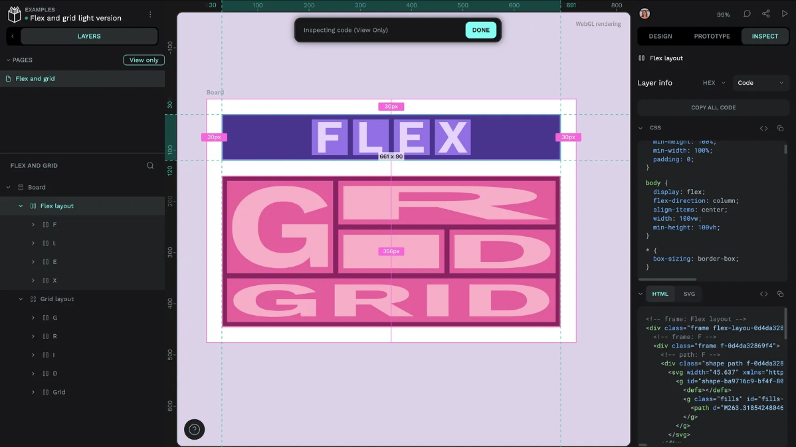

# Current product design notes

Official product visuals reproduced for attributed design commentary. These are not screenshots from Rupesh's account or evidence of hands-on testing.

## notion-column-permissions

Source: https://www.notion.com/releases/2026-10-13

## linear-stacked-prs

Source: https://linear.app/changelog/2026-10-08-stacked-pull-requests

## penpot-inspect

Source: https://penpot.app/blog/figma-to-penpot-terminology-cheatsheet/
