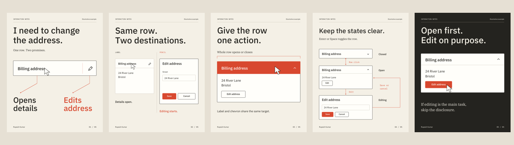
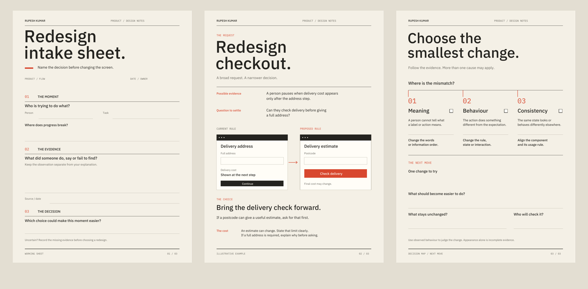
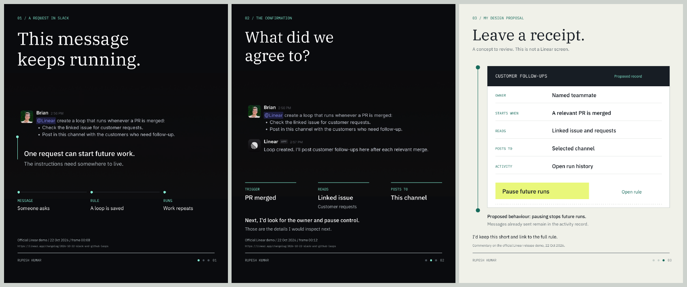
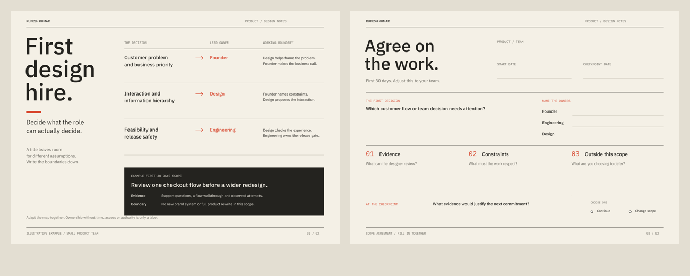

# Product design notes: screenshots, interaction studies and working sheets

These materials accompany Rupesh Kumar's product design commentary. Product screenshots preserve the original interface. Original proposals and worked examples are labelled as illustrations, and are not presented as client work or tested product features.

| Publication slot, IST | Format | File | Preview |
| --- | --- | --- | --- |
| 26 October, 6 PM | 5-page carousel | [When the icon and label disagree](when-icon-label-disagree.pdf) | [All pages](when-icon-label-disagree-contact.png) |
| 27 October, 9 AM | Product screenshot | [Penpot grid rules](penpot-grid.png) | Same image |
| 27 October, 6 PM | 3-page fillable resource | [Redesign intake sheet](redesign-intake-sheet.pdf) | [All pages](redesign-intake-sheet-contact.png) |
| 28 October, 9 AM | Interface comparison | [DHL navigation example](smashing-dhl.png) | Same image |
| 28 October, 6 PM | 3-page carousel | [When automation starts elsewhere](loop-receipt-carousel.pdf) | [All pages](loop-receipt-carousel-contact.png) |
| 29 October, 9 AM | Product screenshot | [Penpot Inspect](penpot-inspect.png) | Same image |
| 29 October, 6 PM | 2-page fillable resource | [First design hire scope](first-design-hire-scope.pdf) | [All pages](first-design-hire-scope-contact.png) |
| 30 October, 9 AM | Product demo frame | [Linear Loop confirmation](linear-loops-frame-12.png) | Same image |

The intake PDF contains 12 text fields and three checkboxes. The scope agreement has 11 text fields and a checkpoint selection. Download the original PDF and open it in a PDF reader to fill and save the fields; a browser or LinkedIn preview may display only the pages.

## Preview the original studies

## Sources and attribution

- Penpot screenshots: Laura Kalbag, [Declarative design with Penpot](https://penpot.app/blog/declarative-design-with-penpot/), 20 October 2026. This is a published guide, not evidence that the illustrated features first shipped on that date.
- DHL screenshot: [Accordion Icons: Which Work Best?](https://www.smashingmagazine.com/2026/10/accordion-icons-which-work-best/), Vitaly Friedman, Smashing Magazine, 23 October 2026. The billing-address carousel is an original illustrative study informed by that discussion.
- Linear frames: [More ways to run and share Loops](https://linear.app/changelog/2026-10-22-slack-and-github-loops), 22 October 2026. The request and confirmation frames are unchanged. The receipt on the last carousel page is an original proposal, not a Linear screen.

The source links establish the published examples. They do not establish hands-on use by Rupesh, usability results, or ownership of the source products.
